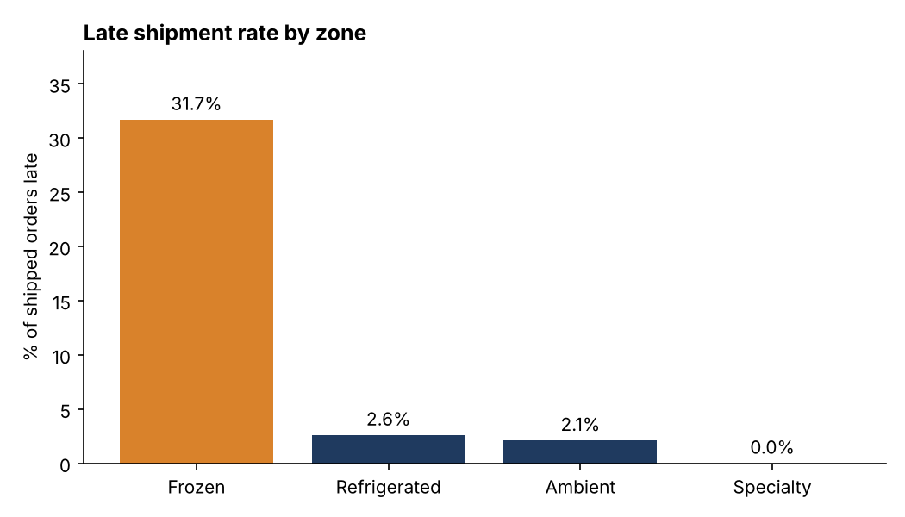
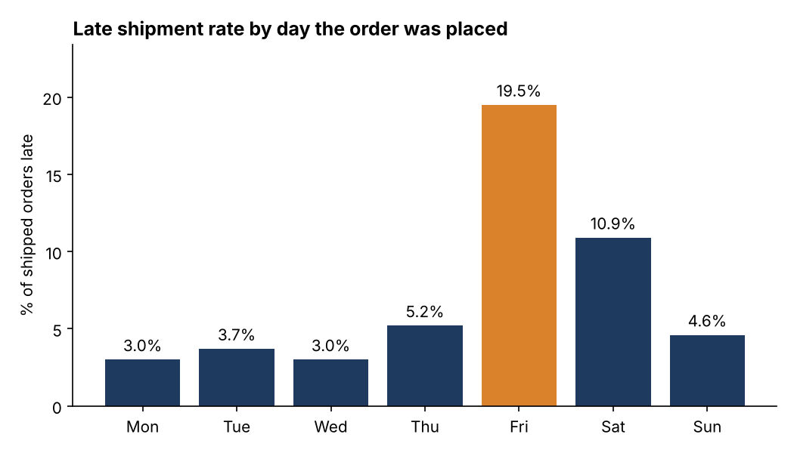
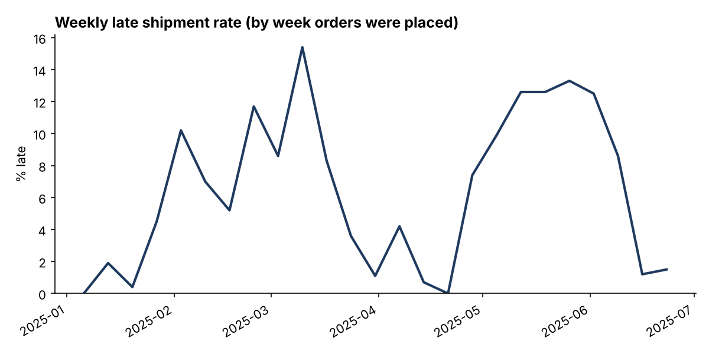

# Project 1: Warehouse Order Aging and Late Shipments

**Question:** Which orders ship late, and where should a warehouse manager act first?

**Tools:** SQL (SQLite), Python (pandas, matplotlib)

> **Data note:** The dataset is synthetic. I generated it with a seeded script (`generate_data.py`)
> that simulates a capacity-limited shipping queue, because real order data is not public. The
> patterns were built into the simulation, so the findings show how I analyze and report, not
> facts about a real warehouse.

## Data

21,950 orders placed between 2025-01-01 and 2025-06-30, across four storage zones (Ambient,
Refrigerated, Frozen, Specialty). Each order has a priority (Standard ship-by is 2 days after
the order date, Expedited is 1 day), a ship-by date, and a shipped date. 170 orders were still
unshipped on the snapshot date. "Late" means shipped after the ship-by date.

## Key findings

**1. Overall, 6.4% of shipped orders were late (1,397 of 21,780).** Average time to ship was
0.74 days.

**2. One zone causes most of the lateness.** Frozen was 15% of shipped orders but 74% of late
ones (1,027 of 1,397).

| Zone | Late rate | Shipped same day | Took 3+ days |
|---|---|---|---|
| Frozen | 31.7% | 29.0% | 31.7% |
| Refrigerated | 2.6% | 52.9% | 2.6% |
| Ambient | 2.1% | 46.8% | 2.1% |
| Specialty | 0.0% | 79.6% | 0.0% |



**3. Orders placed on Friday are the most likely to be late (19.5%).** Saturday orders follow at
10.9%. Monday to Wednesday run between 3.0% and 3.7%. Shipping data shows why this is plausible: 3,800 to 4,300
orders leave on each weekday, only 1,168 on Saturdays, and none on Sundays.



**4. Expedited orders are protected, standard orders are not.** Expedited orders were 0.0% late
across 3,318 orders. Standard orders were 7.6% late.

**5. The month-end volume bump did not change the late rate.** Orders placed in the last three
days of a month were late 6.4% of the time, the same as every other day. I checked this because
it was a likely explanation, and ruled it out.

**6. The late rate is not steady.** It ranged from 0% to 15.4% by week, with a sustained stretch
of roughly 10 to 13% from early May to early June.



**7. Backlog at the end of the period is small and young.** 170 orders were open on 2025-06-30,
and only one was already past its ship-by date.

## Recommendations

1. **Fix Frozen first.** It accounts for about three quarters of late orders. Add shipping
   capacity for that zone (labor, staging, or dock time) and review its daily cutoff.
2. **Cover the weekend for Friday orders.** Friday-placed standard orders run into a weekend with
   one reduced shipping day. Either add partial weekend shifts or change the promised ship-by
   date for Friday orders.
3. **Use a weekly alert.** A weekly late rate above about 10% for two or more weeks should
   trigger a staffing review.
4. **Simple what-if:** if Frozen performed like Refrigerated (2.6% late), the overall late rate
   would drop from 6.4% to roughly 2%.

## Limitations

- The data has no labor or staffing hours, so I cannot prove capacity is the cause. The
  same-day shipping rate and the weekend shipment volumes are the evidence that points to it.
- The late rate only counts orders that have shipped. Open orders are reported separately.
- Synthetic data: relationships come from the simulation, not from a real operation.

## Files

| File | Purpose |
|---|---|
| `generate_data.py` | Builds `data/orders.csv` (seeded, repeatable) |
| `queries.sql` | All SQL, one named block per question |
| `analysis.py` | Runs the SQL, saves charts, writes `results.md` |
| `results.md` | Every query result as a table |
| `charts/` | PNG charts used above |

## Run it

```
pip install -r ../requirements.txt
python generate_data.py
python analysis.py
```
