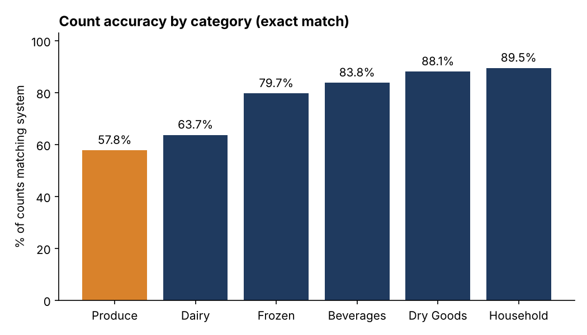
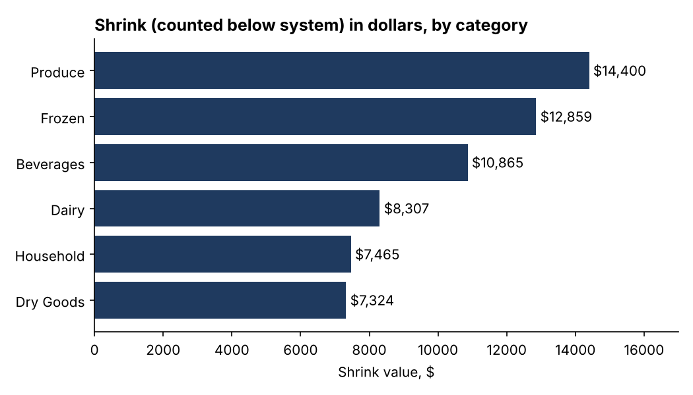
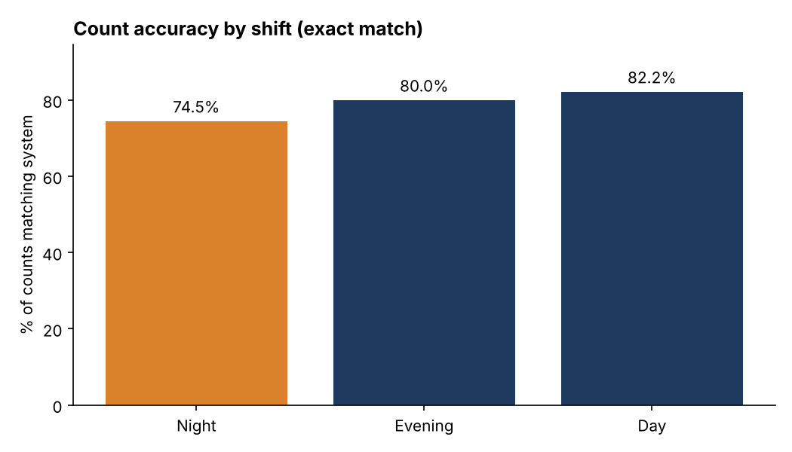
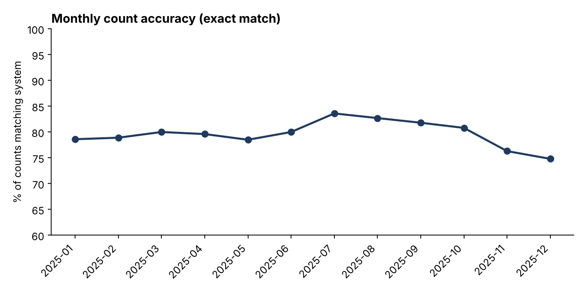

# Project 2: Cycle Count Accuracy and Inventory Shrink

**Question:** Where is the inventory record wrong, which errors cost the most, and what should
be counted or fixed first?

**Tools:** SQL (SQLite), Python (pandas, matplotlib)

> **Data note:** The dataset is synthetic. I generated it with a seeded script
> (`generate_data.py`) because real inventory data is not public. The error patterns were built
> into the generator, so the findings show how I analyze and report, not facts about a real
> warehouse.

## Data

1,200 SKUs across six categories and 5,414 cycle counts during 2025. A-class SKUs are counted
monthly, B-class quarterly, C-class twice a year. Each count records the system quantity, the
counted quantity, the shift, and the counter. A count is "exact" when the two quantities match.

## Key findings

**1. 79.6% of counts matched the system exactly, and 82.3% were within 2%.** Net variance was
-6,850 units (-$38,338): the count came in below the system far more often than above it.
Gross variance, ignoring direction, was $84,100.

**2. Shrink was 2.7 times larger than overage.** Counts below the system added up to $61,219
and counts above the system to $22,881. A gap that lopsided points to a systematic cause, such
as unrecorded waste or receiving errors, rather than random counting noise.

**3. Perishables are the least accurate.**

| Category | Exact match | Shrink ($) |
|---|---|---|
| Produce | 57.8% | $14,400 |
| Dairy | 63.7% | $8,307 |
| Frozen | 79.7% | $12,859 |
| Beverages | 83.8% | $10,865 |
| Dry Goods | 88.1% | $7,324 |
| Household | 89.5% | $7,465 |



**4. Accuracy rank and dollar rank are not the same.** Frozen has the third lowest accuracy but the second highest
shrink dollars, because its items cost more. Ranking by count accuracy alone would send effort
to the wrong place.



**5. Night shift is the least accurate: 74.5%, against 82.2% for day shift.** Evening was 80.0%.
The gap is not just a category mix effect: night had the lowest exact-match rate in five of six
categories (the exception was Household). The three night counters were all below 76%.



**6. A small group of SKUs holds most of the dollar variance.** The top 10% of SKUs account for
69.3% of gross dollar variance. All ten of the worst SKUs are A-class, and nine of them are
Frozen, Produce, or Dairy items. A-class as a whole holds $67,159 of the $84,100 gross variance.

**7. Accuracy dropped during the holiday months.** It fell from 80.8% in October to 76.3% in
November and 74.8% in December, after peaking at 83.6% in July.



## Recommendations

1. **Target the top-decile SKUs.** Run root cause reviews on the high-dollar A-class Frozen,
   Produce, and Dairy items first, and consider more frequent counts on them.
2. **Investigate perishable adjustments.** Check how waste, spoilage, and receiving are logged
   for Produce and Dairy, since the loss is mostly one directional.
3. **Add a verification step on night shift.** For example, a blind recount whenever a variance
   exceeds a set threshold, and refresher training for the night counters.
4. **Plan for November and December.** Add counting hours or move non-essential counts out of
   the peak weeks.

## Limitations

- Counter assignments in the synthetic data are random. In a real warehouse, shifts may count
  different locations or product types, so I would test for that before blaming a shift.
- I used exact match and a 2% tolerance. A real operation would set tolerances by item value.
- Synthetic data: relationships come from the generator, not from a real operation.

## Files

| File | Purpose |
|---|---|
| `generate_data.py` | Builds `data/skus.csv` and `data/cycle_counts.csv` (seeded, repeatable) |
| `queries.sql` | All SQL, one named block per question |
| `analysis.py` | Runs the SQL, saves charts, writes `results.md` |
| `results.md` | Every query result as a table |
| `charts/` | PNG charts used above |

## Run it

```
pip install -r ../requirements.txt
python generate_data.py
python analysis.py
```
