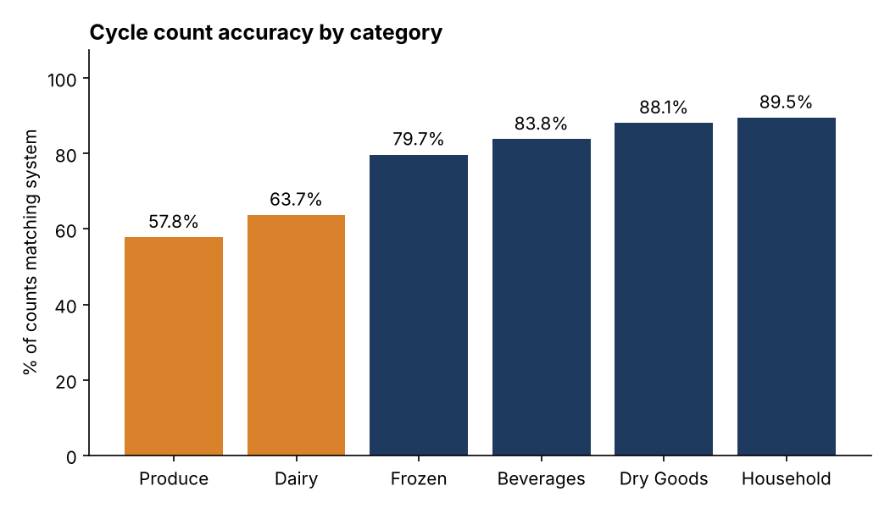
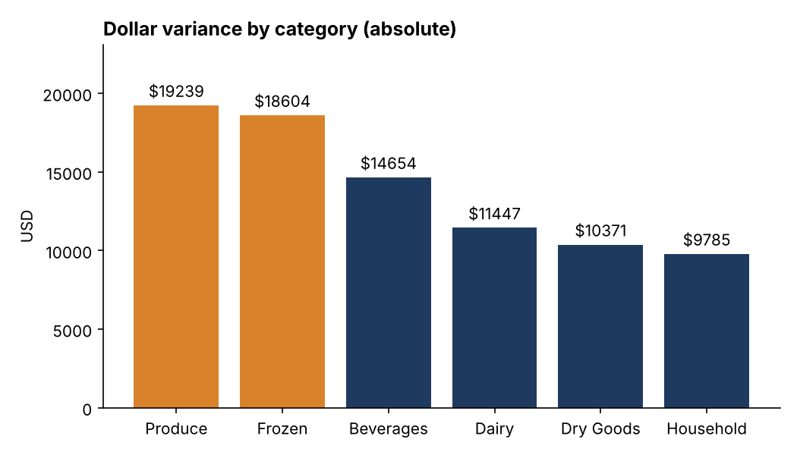
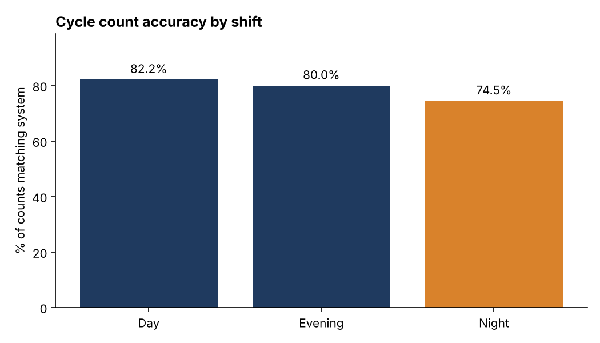
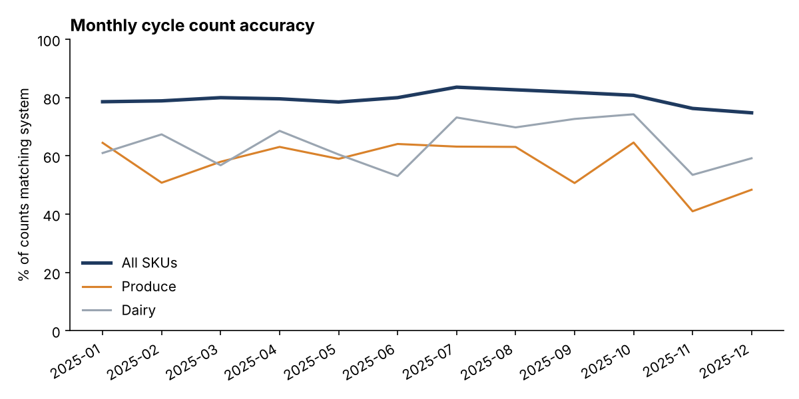

# Project 2: Cycle Count Accuracy

**Question:** How accurate are the warehouse's cycle counts, where are the errors coming from, and
what should an inventory manager change first?

**Tools:** SQL (SQLite), Python (pandas, matplotlib)

> **Data note:** The dataset is simulated, because real cycle count data is not public. The
> findings show how I analyze and report on inventory accuracy, not facts about a real warehouse.

## Data

5,414 cycle counts of 1,200 SKUs between 2025-01-01 and 2025-12-26, joined to a SKU table with
category, ABC class, and unit cost. Each count records the system quantity, the counted quantity,
the shift, and the counter. A count is **accurate** when the counted quantity matches the system
quantity exactly. **Variance** is counted minus system, so a negative number means the shelf held
less than the system said. Dollar variance uses unit cost.

## Key findings

**1. Only 79.6% of counts matched the system exactly.** Allowing a 2% tolerance only lifts that to
82.3%, so most misses are real differences, not rounding. Many warehouses aim for 95% or better.

**2. Errors lean heavily toward shortages.** 14.7% of counts came up short and only 5.7% came up
over. Net variance was -$38,338 on $84,100 of total absolute variance. That pattern points to
unrecorded loss (spoilage, damage, mis-picks) rather than random miscounting, which would be
closer to even.

**3. Perishables are the weak spot.** Produce matched only 57.8% of the time and Dairy 63.7%,
against 88 to 90% for Dry Goods and Household. Almost a third of Produce counts (30.8%) were
short.

| Category | Accuracy | Counts short | Absolute $ variance |
|---|---|---|---|
| Produce | 57.8% | 30.8% | $19,239 |
| Dairy | 63.7% | 24.1% | $11,447 |
| Frozen | 79.7% | 14.0% | $18,604 |
| Beverages | 83.8% | 12.5% | $14,654 |
| Dry Goods | 88.1% | 8.9% | $10,371 |
| Household | 89.5% | 7.5% | $9,785 |



**4. Produce and Frozen carry 45% of the dollar exposure.** Frozen's accuracy looks average, but
its misses are expensive, so it ranks second on dollars.



**5. Night shift is about 8 points worse than day shift (74.5% vs 82.2%).** I checked whether that
was just a different category mix on nights. It is not: the category mix is nearly identical
across shifts, and nights score lowest in five of six categories. Night Produce counts matched
only 45.3% of the time. One caveat: each counter works only one shift, so this data cannot
separate a shift problem (lighting, staffing, fatigue) from the three night counters themselves.



**6. Counting A items more often is not making them more accurate.** A items are counted 12
times per SKU, B items 4 times, and C items twice, which matches standard ABC practice. But
accuracy is flat at 79 to 80% in all three classes. A items still hold 80% of the dollar variance
($67,159 of $84,100), mostly because they are counted most often. More counts find the errors but
do not fix the cause.

**7. Accuracy drops in November and December.** It fell from about 82% in July to October to
about 75% in November and December. Produce drove most of it, falling to 44.8% in those two months
compared with 60.1% the rest of the year.



## Recommendations

1. **Run root-cause checks on Produce and Dairy shortages.** Compare short counts against spoilage
   and markdown logs. If the loss is spoilage that never gets recorded, the fix is a disposal scan
   step, not more counting.
2. **Audit the night count process.** Pair one night counter with a day counter for two weeks of
   blind recounts. That separates a person problem from a shift-conditions problem.
3. **Add a root-cause code to every miss on A items.** Frequent counting is already in place. A
   reason code (mis-pick, receiving error, damage, unrecorded waste) turns those counts into fixes.
4. **Plan for the holiday season.** Add Produce recounts and tighter receiving checks starting in
   November, before accuracy drops.
5. **Track two numbers weekly:** exact-match accuracy by category, and net dollar variance. A net
   variance that keeps going negative is the early sign of unrecorded loss.

## Limitations

- No receiving, picking, or waste data, so the causes of shortages are inferred from patterns, not
  proven.
- Counters are tied to shifts, so shift and counter effects cannot be separated.
- Each count is a single snapshot. The data does not show whether a variance was corrected later.
- Simulated data: the relationships come from the simulation, not a real operation.

## Files

| File | Purpose |
|---|---|
| `data/cycle_counts.csv` | One row per count |
| `data/skus.csv` | SKU category, ABC class, and unit cost |
| `queries.sql` | All SQL, one named block per question |
| `analysis.py` | Runs the SQL, saves charts, writes `results.md` |
| `results.md` | Every query result as a table |
| `charts/` | PNG charts used above |

## Run it

```
pip install pandas matplotlib
python analysis.py
```
