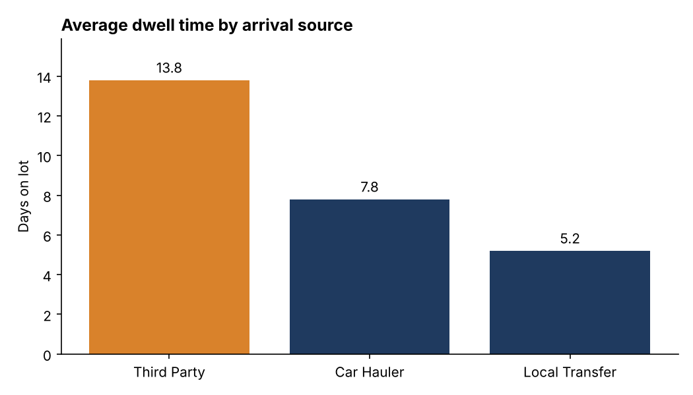
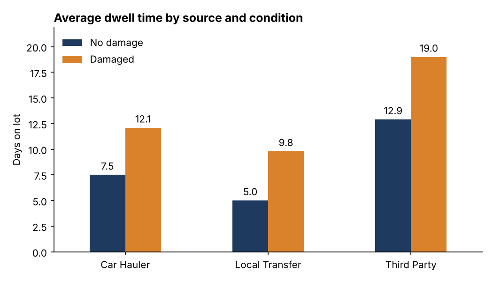
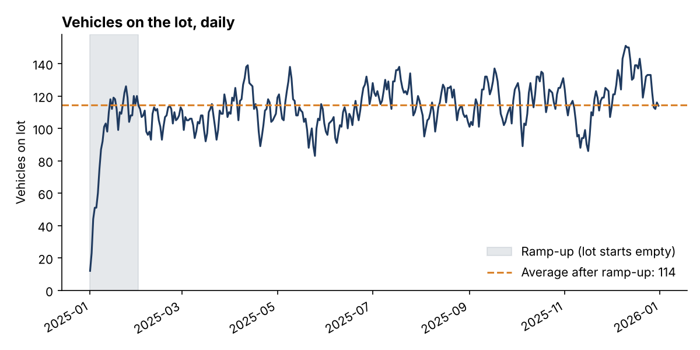

# Project 3: Vehicle Lot Dwell Time and Lot Utilization

**Question:** What makes vehicles sit on the lot longer, and how much lot space does that cost?

**Tools:** SQL (SQLite, including window functions and recursive CTEs), Python (pandas,
matplotlib)

> **Data note:** The dataset is synthetic. I generated it with a seeded script
> (`generate_data.py`), and it contains no real vehicles or VINs. The relationships were built
> into the generator, so the findings show how I analyze and report, not facts about a real lot.

## Data

4,500 vehicles that arrived during 2025, with arrival source (Car Hauler, Third Party, Local
Transfer), vehicle type, damage on arrival, lot section, and arrival and departure dates.
114 vehicles were still on the lot on 2025-12-31.

**Method note:** Dwell time is only known for vehicles that have left. To avoid understating it,
dwell statistics use vehicles that arrived by 2025-11-30 and have departed (4,075 vehicles). All
114 vehicles still on the lot arrived in December, so no earlier vehicle is missing because it has not left yet.

## Key findings

**1. Average dwell is 9.3 days (median 8.0), and 15.0% of vehicles stay longer than 14 days.**

**2. Third-party vehicles dwell about twice as long as car hauler vehicles.**

| Source | Avg dwell | Median | Over 14 days | Damage rate |
|---|---|---|---|---|
| Third Party | 13.8 days | 12.0 | 37.1% | 14.7% |
| Car Hauler | 7.8 days | 7.0 | 6.2% | 5.2% |
| Local Transfer | 5.2 days | 5.0 | 1.5% | 3.0% |



**3. Damage adds 5 to 6 days, and it does so within every source.** Damaged vehicles stayed
16.0 days on average against 8.7 for undamaged, and 49.4% of them passed 14 days. Because
third-party vehicles are also damaged more often, I checked each source separately. Damage added
4.6 days for car haulers, 4.8 for local transfers, and 6.1 for third party.



**4. The worst combination is a damaged third-party vehicle.** Those averaged 19.0 days on the
lot, against 7.5 for an undamaged car hauler vehicle.

**5. Smaller factors:** Trucks average 10.8 days against 8.3 for sedans. Weekend arrivals average
10.2 days against 9.1 for weekday arrivals (428 weekend vehicles).

**6. The extra third-party dwell ties up about 23 lot spaces.** The gap between third-party and
car hauler dwell, across 1,253 third-party vehicles, adds up to about 7,600 extra vehicle-days.
Spread over the 334-day analysis window, that is roughly 23 spaces occupied at all times, about a
fifth of the average lot population of 114.

**7. The lot ran between 83 and 151 vehicles after the January ramp-up, averaging 114.** The
highest point came in December.



## Recommendations

1. **Tighten third-party intake.** Require a condition report before arrival, and flag any
   third-party vehicle that passes 10 days so it gets a named owner.
2. **Set a damage resolution target.** Damaged vehicles are about 8% of vehicles but
   roughly a quarter of the stays over 14 days, so give repair and claim decisions a clear
   deadline, such as 7 days.
3. **Plan lot capacity for the peak, not the average.** The lot reached 151 vehicles against an
   average of 114.
4. **Quantify the payoff:** cutting third-party dwell halfway to the car hauler level would free
   roughly 11 spaces on average.

## Limitations

- Dwell has other drivers I cannot see here, such as paperwork, repair backlog, and dispatch
  availability. The data shows where dwell is high, not why.
- Synthetic data: relationships come from the generator, not from a real operation.
- Lot capacity is not in the data, so I describe spaces freed, not percent of capacity.

## Files

| File | Purpose |
|---|---|
| `generate_data.py` | Builds `data/vehicles.csv` (seeded, repeatable) |
| `queries.sql` | All SQL, one named block per question |
| `analysis.py` | Runs the SQL, saves charts, writes `results.md` |
| `results.md` | Every query result as a table |
| `charts/` | PNG charts used above |

## Run it

```
pip install -r ../requirements.txt
python generate_data.py
python analysis.py
```
